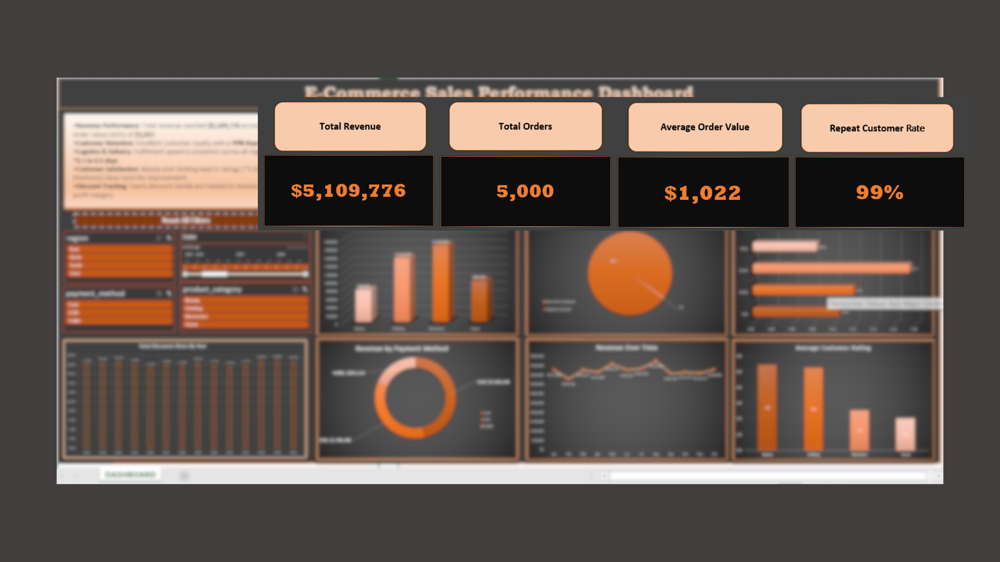

# 📊 E-Commerce Sales Performance Dashboard

An interactive, dark-mode Business Intelligence dashboard built in Microsoft Excel to analyze e-commerce sales performance, operational fulfillment, and customer satisfaction.
---
## Dashboard Preview


## 🚀 Project Overview
This project transforms raw e-commerce order data into actionable business intelligence. It is designed to provide stakeholders with an executive-level overview of financial metrics, customer loyalty, logistics turnaround times, and product category performance—all within a single, interactive viewport.
---
## 🔍 Dashboard Component Breakdown
Below is a closer look at the core interactive elements and visual components built into the dashboard, along with their business purpose and technical implementation.
---
### 1. Executive KPI Cards Panel


* **Purpose:** Provides stakeholders with an immediate, high-level snapshot of overall business health—showcasing core metrics including **Total Revenue ($5,109,776)**, **Total Orders (5,000)**, **Average Order Value ($1,022)**, and **Repeat Customer Rate (99%)**.
* **How It Was Built:** 
  * Created custom styled card containers featuring a high-contrast dark background paired with peach/orange label headers.
  * Linked the numeric values dynamically to underlying PivotTable summary cells using direct cell references (`=Sheet!Cell`), ensuring real-time updates when filters are modified.
---
### 2. Executive Summary & Key Insights Panel


* **Purpose:** Provides a structured, text-based narrative breakdown of business performance directly on the dashboard—highlighting key takeaways in Revenue, Customer Retention, Logistics, Product Satisfaction, and Discount Trends for quick executive scanning.
* **How It Was Built:** 
  * Designed a clean, rounded text box panel with a warm peach/tan background to contrast against the dark dashboard theme.
  * Populated with concise bullet points derived from underlying PivotTable metrics to tell a clear data story without overwhelming the audience with raw numbers.
---
### 3. Interactive Slicers & Timeline Filter


* **Purpose:** Empowers users to dynamically filter and slice performance data across multiple dimensions—**Region**, **Date (Timeline)**, **Payment Method**, and **Product Category**—for interactive exploration.
* **How It Was Built:** 
  * Inserted native Excel **Slicers** and a **Timeline** control connected to the primary data models.
  * Applied a custom color palette to match the dark-mode aesthetic and synchronized all slicers across every chart using **Report Connections** for seamless multi-dimensional cross-filtering.
---
### 4. "Reset All Filters" Action Button


* **Purpose:** Improves user experience (UX) by enabling executives and clients to clear multiple active filter states simultaneously and restore the default full-dataset view with a single click.
* **How It Was Built:** 
  * Designed a custom action button shape positioned strategically above the filter panel.
  * Linked a lightweight **VBA Macro** to target active SlicerCaches and clear selections instantly across the workbook.
---

### 5. Performance & Operational Charts Grid


* **Purpose:** Translates transaction rows into visual insights—tracking **Revenue by Product Category**, **Customer Segmentation**, **Average Delivery Days**, **Revenue by Payment Method**, **Revenue Over Time**, and **Average Customer Rating**.
* **How It Was Built:** 
  * Built dedicated backend PivotTables for each chart category to maintain fast calculation performance.
  * Formatted PivotCharts by stripping away clutter, gridlines, and field buttons, applying a consistent warm orange data series theme tailored to the dark-mode UI/UX layout.
---
## 📌 Key Metrics & Insights
* **Total Revenue:** Tracked **$5,109,776** across **5,000 orders** with an Average Order Value (AOV) of **$1,022**.
* **Customer Retention:** Identified an exceptional **99% Repeat Customer Rate**, highlighting strong brand loyalty.
* **Logistics & Delivery:** Evaluated fulfillment speeds across regions (*East, North, South, West*), averaging **~6.1 to 6.6 days**.
* **Product Performance & Satisfaction:** Cross-examined revenue vs. customer satisfaction ratings—revealing *Beauty* and *Clothing* as top revenue and satisfaction leaders (~3.0/5 rating).
* **Discount Tracking:** Monitored yearly average discount trends to safeguard profit margins and evaluate promotional impact.

---

## 🛠️ Tools, Techniques, & Features
* **Data Modeling & Preparation:** Excel Tables, Pivot Tables, Advanced Formulas (`YEAR`, `AVERAGE`, `SUM`,`INDEX`,`MATCH`,`Macro`,`DAX`).
* **UI/UX & Design:** Custom dark-mode aesthetic with warm accents, structured grid layout, and hidden gridlines for a clean, application-like feel.
* **Interactivity:** Synchronized **Slicers** allowing multi-dimensional cross-filtering by Region, Date, Payment Method, and Product Category.

---

## 📂 Repository Structure
```text
├── ecommerce-sales-performance-dashboard.xlsx   # Main Excel Workbook containing Data & Dashboard
├── assets/
│   └── dashboard-demo.gif                       # Interactive preview GIF
└── README.md                                    # Project documentation
