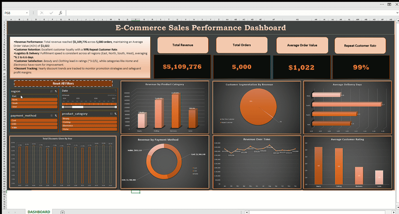
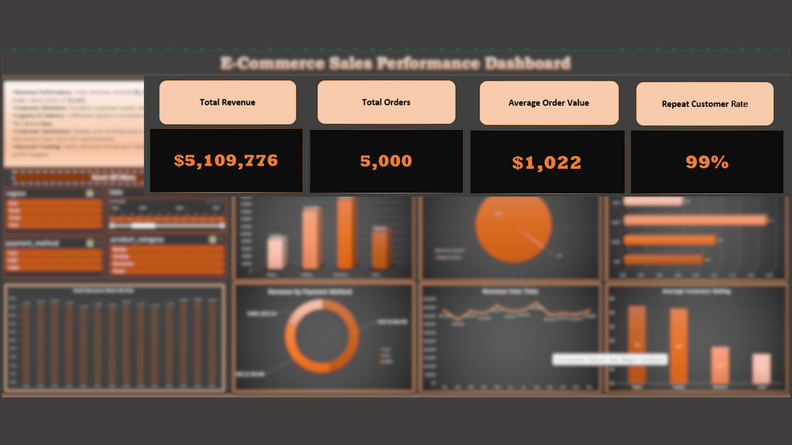
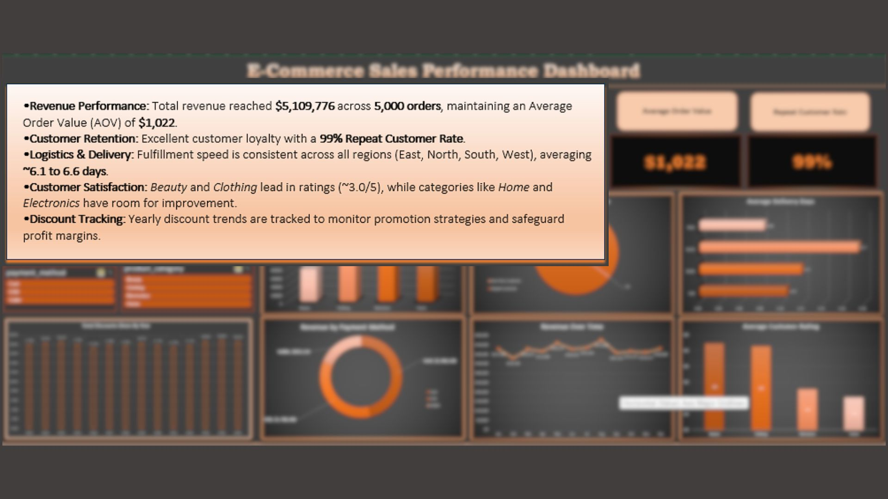
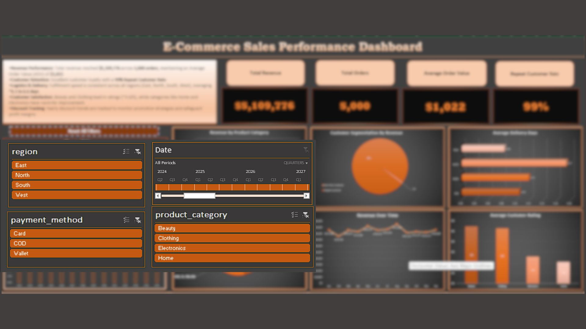
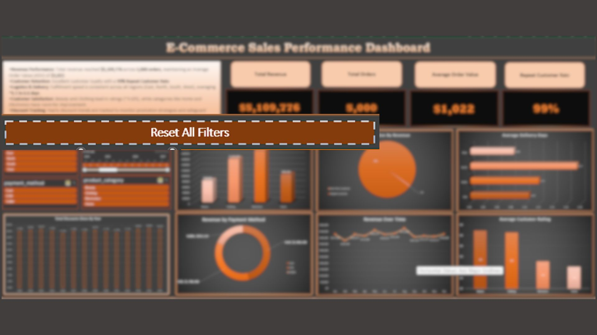
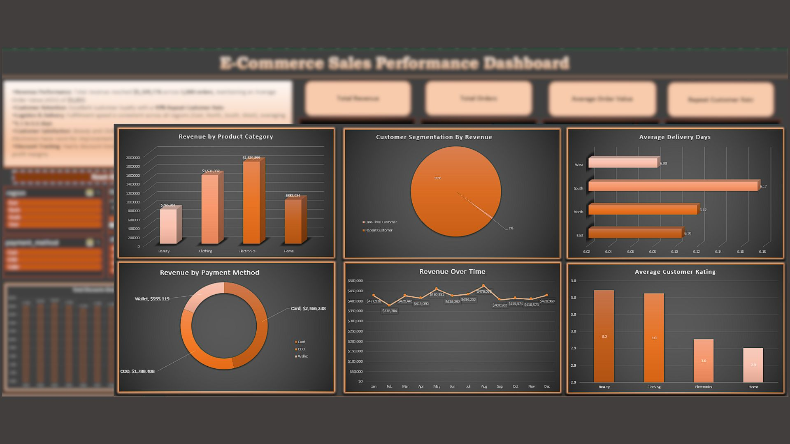

# 📊 E-Commerce Sales Performance Dashboard

An interactive, dark-mode Business Intelligence dashboard built in Microsoft Excel to analyze e-commerce sales performance, operational fulfillment, and customer satisfaction.

---

## Dashboard Preview



## 🚀 Project Overview
This project transforms raw e-commerce order data into actionable business intelligence. It is designed to provide stakeholders with an executive-level overview of financial metrics, customer loyalty, logistics turnaround times, and product category performance—all within a single, interactive viewport.  

---


## 🔍 Dashboard Component Breakdown
Below is a closer look at the core interactive elements and visual components built into the dashboard, along with their business purpose and technical implementation.

---

### 1. Executive KPI Cards Panel



* **Business Value & Purpose:** Delivers an immediate, high-level executive snapshot of overall business health, tracking critical core metrics: **Total Revenue ($5,109,776)**, **Total Orders (5,000)**, **Average Order Value ($1,022)**, and **Repeat Customer Rate (99%)**.
* **Technical Architecture & Implementation:**
    * **Real-Time Interactivity:** Established multi-dimensional cross-filtering via synchronized Slicers and Timelines.
    * **Resilient Data Pipeline & Backend Calculation:** To ensure the front-end dashboard remains 100% dynamic and immune to layout shifts when users interact with global Slicers, I engineered an isolated backend calculation pipeline:
    * **Dedicated Calculation Engine (`Customers` Tab):** Raw PivotTables aggregate metrics behind the scenes on a dedicated backend sheet, keeping the dashboard canvas clean and uncluttered.
    * **Bulletproof `INDEX/MATCH` Anchoring:** Protected against layout shifts caused by expanding or contracting PivotTable rows by locking lookups to static markers like `"Grand Total"`:

  ```excel   
      =INDEX($H$7:$H$10, MATCH("Grand Total", $G$7:$G$10, 0))
   ```
   
   * **Front-End Shape Binding:** Front-end KPI container shapes are dynamically linked directly to these isolated helper cells via the formula bar (using =Customers!B21), guaranteeing instant, error-free reactivity across global Slicers       without breaking when PivotTables expand or contract.
* **UI/UX & Design Engineering:** 
  * Designed custom container shapes configured with a professional, high-contrast dark-mode aesthetic.
  * Applied deliberate color theory featuring distinct peach/orange label headers paired with crisp, weighted typography to optimize visual hierarchy and direct executive attention to high-impact financial metrics.
  
---

### 2. Executive Summary & Key Insights Panel



* **Business Value & Purpose:** Provides a structured, text-based narrative breakdown of core business performance directly on the dashboard. Designed specifically for **rapid executive scanning**, delivering immediate answers and high-level takeaways for stakeholders who require instant clarity without sorting through granular chart details.
* **Technical Architecture & UI/UX Design:**
  * **Visual Contrast & Readability:** Built a dedicated, rounded text box panel utilizing a warm peach/tan background tone to create a sharp, intentional contrast against the dark-mode dashboard theme.
  * **Data Storytelling:** Populated with concise, bulleted business insights synthesized directly from underlying PivotTable metrics, transforming raw data into a clear, compelling narrative.
---
### 3. Interactive Slicers & Timeline Filter



* **Business Value & Purpose:** Empowers users and stakeholders to dynamically filter and slice performance data across multiple dimensions—including **Region, Date (Timeline), Payment Method, and Product Category**—enabling seamless, ad-hoc exploratory analysis.
* **Technical Architecture & Implementation:**
  * **Interactive Controls:** Integrated native Excel Slicers and a Timeline control directly linked to the underlying PivotTables and data model.
  * **Cross-Filtering Synchronization:** Configured **Report Connections** to synchronize all slicers across multiple charts simultaneously, ensuring that filtering one component instantly updates the entire dashboard for a unified, multi-dimensional user experience.
* **UI/UX & Design Engineering:** Styled with custom color palettes meticulously matched to the dashboard's dark-mode theme to maintain a cohesive, professional aesthetic throughout the interface.
---
### 4. "Reset All Filters" Action Button



* **Business Value & Purpose:** Dramatically improves user experience (UX) by eliminating the friction of manually clearing multiple slicers individually. Enables executives and stakeholders to wipe all active filter states simultaneously and restore the default full-dataset view with a single click.
* **Technical Architecture & Implementation:**
  * **Custom Action Interface:** Designed a sleek, custom button shape positioned strategically near the filter panel for intuitive and immediate accessibility.
  * **VBA Macro Automation:** Programmed and linked a lightweight VBA macro targeting specific active `SlicerCache` objects, executing instant multi-filter clearance across the workbook:
```vba
Sub ClearFilters()
    ActiveWorkbook.SlicerCaches("Timeline_Date").ClearDateFilter
    ActiveWorkbook.SlicerCaches("Slicer_product_category").ClearManualFilter
    ActiveWorkbook.SlicerCaches("Slicer_region").ClearManualFilter
    ActiveWorkbook.SlicerCaches("Slicer_payment_method1").ClearManualFilter
End Sub
```
---

### 5. Performance & Operational Charts Grid



* **Business Value & Purpose:** Translates raw transactional rows into clear, visual insights—tracking critical metrics such as **Revenue by Product Category, Customer Segmentation, Average Delivery Days, Revenue by Payment Method, Revenue Over Time, and Average Customer Rating**.
* **Technical Architecture & Implementation:**
  * **Optimized Data Models:** Built dedicated backend PivotTables for each chart category to maintain fast, efficient calculation performance across the workbook.
  * **PivotChart Integration:** Inserted and configured dynamic PivotCharts directly linked to underlying data summaries, selecting the optimal chart type (bar, column, donut/pie, etc.) best suited for each specific metric's data distribution.
* **UI/UX & Design Engineering:** 
  * Cleaned up visual clutter by stripping away unnecessary gridlines and default field buttons.
  * Applied a consistent warm orange data series theme meticulously tailored to complement the dashboard's dark-mode layout, ensuring high legibility and a polished, executive-ready appearance.
---
## 📌 Key Metrics & Insights
* **Total Revenue:** Tracked **$5,109,776** across **5,000 orders** with an Average Order Value (AOV) of **$1,022**.
* **Customer Retention:** Identified an exceptional **99% Repeat Customer Rate**, highlighting strong brand loyalty.
* **Logistics & Delivery:** Evaluated fulfillment speeds across regions (*East, North, South, West*), averaging **~6.1 to 6.6 days**.
* **Product Performance & Satisfaction:** Cross-examined revenue vs. customer satisfaction ratings—revealing *Beauty* and *Clothing* as top revenue and satisfaction leaders (~3.0/5 rating).
* **Discount Tracking:** Monitored yearly average discount trends to safeguard profit margins and evaluate promotional impact.

     | Metric | Value |
     | :--- | :--- |
     | **Total Revenue** | $5,109,776 |
     | **Total Orders** | 5,000 |
     | **Average Order Value (AOV)** | $1,022 |
     | **Repeat Customer Percentage** | 99% |
---

### 🛠️ Tools, Techniques, & Features

* **Data Modeling & Architecture:** 
  * Structured **Excel Tables**, **Power Query** and **PivotTables** as the core backend foundation.
  * Advanced formulas and lookups (`INDEX`, `MATCH`, `SUM`, `AVERAGE`, `YEAR`, `DAX`) paired with **Helper Cells** for dynamic and flexible metric calculations.
* **Automation & Interactivity:** 
  * **Synchronized Slicers & Timeline Filter** enabling multi-dimensional cross-filtering across Region, Date, Payment Method, and Product Category.
  * Lightweight **VBA Macro** targeting active `SlicerCaches` to execute instant 1-click **"Reset All Filters"** automation.
* **UI/UX & Visual Design:** 
  * Custom dark-mode aesthetic featuring high-contrast warm orange/peach accents, intentional **Visual Hierarchy**, and custom container shapes.
  * Polished application-like layout built by stripping away unnecessary gridlines and default chart clutter for an executive-ready finish.

---

### 📁 Repository Structure

```text
├── Assets/
│   └── dashboard-preview.png
├── workbook/
│   └── Ecommerce Sales Dashboard Project Portfolio.xlsm
└── README.md
```
---

### 💻 How to Use

1. Download the `.xlsm` workbook from the `workbook/` folder.
2. Open the file in Microsoft Excel (Desktop version recommended for full VBA & Slicer support).
3. If prompted for write access or a password, select **Read Only** to explore the dashboard safely without altering the underlying data structure.
4. Click **Enable Content** on the yellow security bar to activate the "Reset All Filters" macro (if blocked by Windows, right-click the downloaded file > *Properties* > check *Unblock*).
5. Use the Slicers and Timeline on the left panel to filter metrics dynamically, and click **Reset All Filters** to restore the default view.

